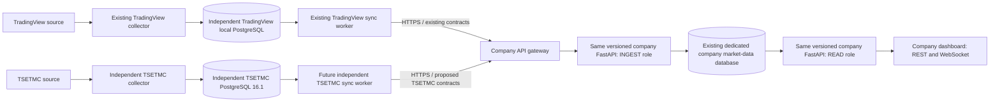

# Milestone 3B-D: shared FastAPI integration design

**PROPOSED — design only, 2026-10-19.** Nothing in this specification is an
implemented TSETMC company endpoint, migration, worker or deployment. Normative
MUST/MUST NOT requirements apply to a later implementation. The nine linked
documents and [wire artifacts](contracts/milestone3b/README.md) form one proposal.

## Verified compatibility baselines

| Object | Inspected revision and evidence |
|---|---|
| TSETMC | `6b95c899a7c78f4f62c580c56eb124eb310f076b`, main, initially clean; package 0.1.0; schema 0003_scheduling; 14 application tables |
| Current public company/TradingView source | `e114a25be8679451f6064ad1fb03c0ef6a8aaefe`, public main checked through GitHub; application __version__=1.1.0rc1; destination head 0010 |
| Frozen company distribution | distributions/marketdata-fastapi-v1.1.0rc1 at that commit; manifest source_revision=4cedaedb172d89ca3d2566bcea477c8296643592 **plus reviewed changes**, source_digest=923310ca1fe20d7cbf1383522c56af3affbafdc8c60d5e1b87a6d70b9d5b4c18 |
| Actual local company handover | Its extracted frozen tree matched all 80 distribution files after the declared LF normalization; ZIP SHA256=334a9969cafe726767d1dd0a4676f674412d61a7c9a0c50473bfa81e9ec61c05 |
| Packaged implementation versus public source | All 41 packaged src/migrations Python files matched public source after LF normalization; no behavioral difference found in those files |
| Older local reference clone | b94d1a22273c2ae955cf2fca2c10a8c99ea8c533, head 0004, lacks the company ingestion work; unsuitable as the integration baseline |
| Company installation | **UNVERIFIED.** The owner clarified that 1.1.0rc1/0010 is the last known prepared baseline, not an independently verified running deployment |

No GitHub Release or tag was listed for the reference repository, and no newer
versioned company distribution appeared in its inspected tree. This establishes
what was publicly available during inspection, not what is installed at the site.
The manifest's old base commit alone cannot reproduce the frozen dirty-workspace
release. [Release manifest](https://github.com/Alpha-lacrim/tradingview-marketdata/blob/e114a25be8679451f6064ad1fb03c0ef6a8aaefe/distributions/marketdata-fastapi-v1.1.0rc1/RELEASE.json),
[M5 qualification](https://github.com/Alpha-lacrim/tradingview-marketdata/blob/e114a25be8679451f6064ad1fb03c0ef6a8aaefe/docs/fastapi-v1.1-milestone5.md).

The original legacy worktree and consolidation worktree have pre-existing changes;
they were inspected read-only, not cleaned, pulled, migrated or executed. Public
source was downloaded into an ignored TSETMC inspection directory. No database,
company host, source API, producer, container or service was contacted/activated.

## One recommended topology

READ/INGEST are roles/factories of **one company FastAPI product**; separate
processes or containers are appropriate and already implemented. Neither role
starts a collector. TSETMC gets its own producer, credentials, epochs, worker
ownership, pending batches and checkpoints. There is no company PostgreSQL DSN on
the collector/worker and no TradingView credential or recovery state in TSETMC.

| Destination alternative | Assessment |
|---|---|
| **Recommended: company_tsetmc schema in the existing dedicated market-data DB** | Separate daily/current/quality/journal tables, shared admin registry and authenticated producer/session/receipt infrastructure; atomic data+receipt+event commits using one DB transaction; one backup boundary |
| Separate TSETMC company DB, same FastAPI | Stronger physical separation but adds pools, credentials, migrations and cross-database receipt/event atomicity problems; defer unless security/capacity requires it |
| Widen existing minute-candle/tick tables | Rejected: daily official close may lie outside the trade range, extra measurements/finality are missing, and TSETMC polls are not ticks |

Schema separation is logical, not physical resource isolation. New producer and
namespace admission limits must reserve capacity for TradingView; test DB/HTTP
contention before activation. Do not claim measured scaling or zero latency impact.

## Protocol and public API decisions

Recommend a **formally named additive ingestion-v1 extension**, contract_version
`tsetmc.v1`, under `/api/ingest/v1/tsetmc/`. New strict models handle four new
stream names: tsetmc_daily, tsetmc_current, tsetmc_coverage, tsetmc_status. Existing
v1 /candles, /quotes, /coverage, /status payloads and their closed Batch model
remain unchanged. This does require new shared grant/recovery validation and SQL
allowlists; it is not plug-compatible with the frozen binary. Receipts/authentication
and session endpoints retain their existing paths and semantics.

READ uses explicit `/api/v1/tsetmc/` routes and `/api/v1/tsetmc/ws/marketdata`
inside the same READ factory. Existing minute-history/price/WS routes must retain
their old shapes and source universe. New TSETMC registry/DTO models express equity/common_stock without widening
legacy AssetClass/InstrumentType wire enums. Legacy registry loaders and route
queries exclude TSETMC before deserializing old Instrument models; new routes
opt into its typed registry view explicitly. New TSETMC event kinds use a separate namespace journal; do not send
them into the legacy renderer, which treats non-price events as minute candles.

Candidate future company release: **1.2.0rc1**, subject to version reservation at
implementation time. It adds destination migration 0011 after verified 0010.
TSETMC source changes start with additive 0004 after 0003_scheduling. No migration
file is created by this design. Do not rebuild or overwrite frozen 1.1.0rc1.

## Source truth and publication invariants

- Only accepted canonical daily values enter the daily stream; unresolved
  candidates stay local. Quality/coverage can report a disagreement without
  accepting the competing measurements.
- Preserve last trade, official close, exact numeric values, source clocks and
  receipt clocks. Never derive a source event time from receipt or a chart label.
- financial_revision and public state_version differ: confirmation, revocation,
  acceptance and quality changes must replicate even when the financial hash stays
  unchanged. Raw-only rechecks do not create financial revisions or price events.
- upstream_finality remains unverified. Local operator confirmation is reversible
  and applies to one financial hash, not an upstream guarantee.
- Allocation uses transactional, instrument/stream-scoped counters held through
  commit, not sequence watermarks. Daily delivery is lossless within the retained
  outbox; latest-current delivery is durably coalescible.
- Company data, imported-observation ledger, event journal and receipt commit
  atomically. A missing HTTP acknowledgment never proves rollback. WebSocket
  delivery is bounded replay plus client deduplication, not exactly once.

## Specification map and verification scope

- [Actual compatibility matrix](milestone-3b-compatibility-matrix.md)
- [Wire contracts and synthetic examples](milestone-3b-wire-contracts.md)
- [Source outbox, seeding and commit-order proof](milestone-3b-source-outbox.md)
- [Company schema, authorization and migration](milestone-3b-company-storage.md)
- [REST, 14 columns, ChartData and WebSocket](milestone-3b-rest-websocket.md)
- [Failure/recovery matrix](milestone-3b-recovery.md)
- [Future implementation acceptance tests](milestone-3b-test-plan.md)
- [Small implementation stages and rollout gates](milestone-3b-implementation-sequence.md)

Current source references: [TSETMC transactions](../src/tsetmc_marketdata/storage/repository.py),
[latest ordering](../src/tsetmc_marketdata/storage/ordering.py),
[operator reviews](../src/tsetmc_marketdata/storage/reviews.py),
[hashes](../src/tsetmc_marketdata/storage/serialization.py),
[ChartData](../src/tsetmc_marketdata/adapters/chartdata.py). Historical 4,662-record
qualification and the still-pending full session remain in the M3A report. No new
live qualification or persistence test is implied by this design task.
